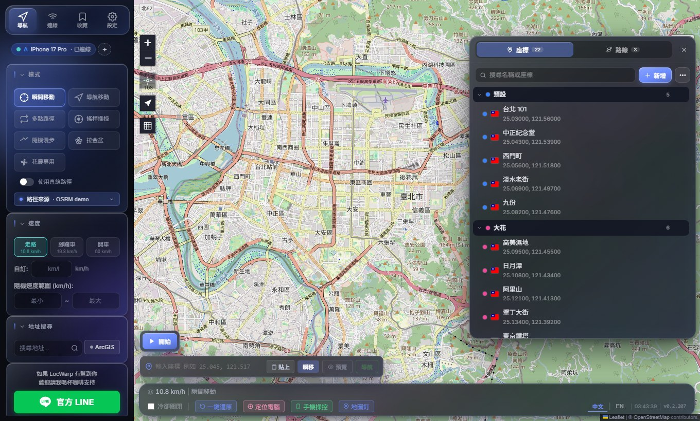
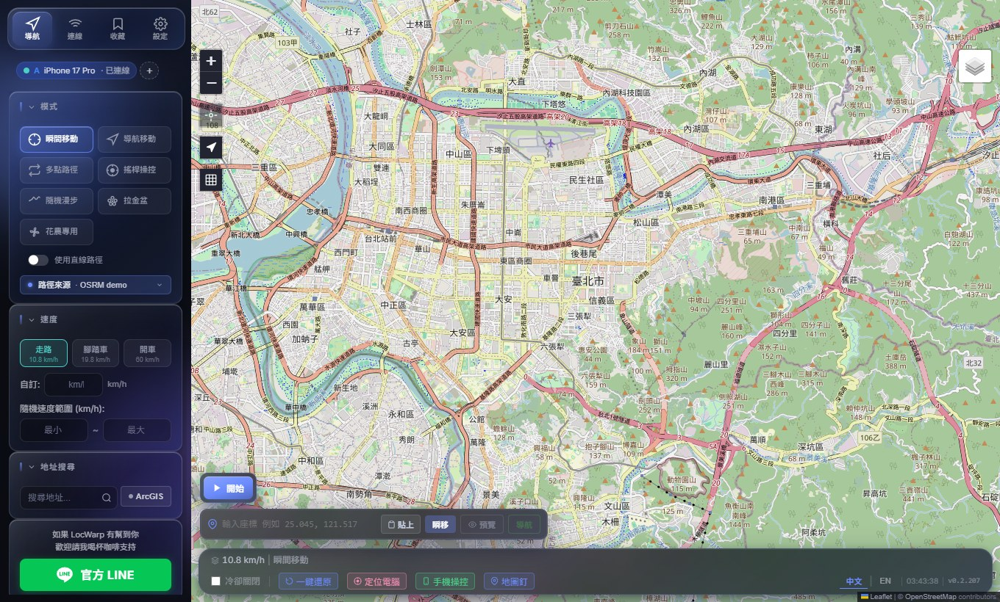
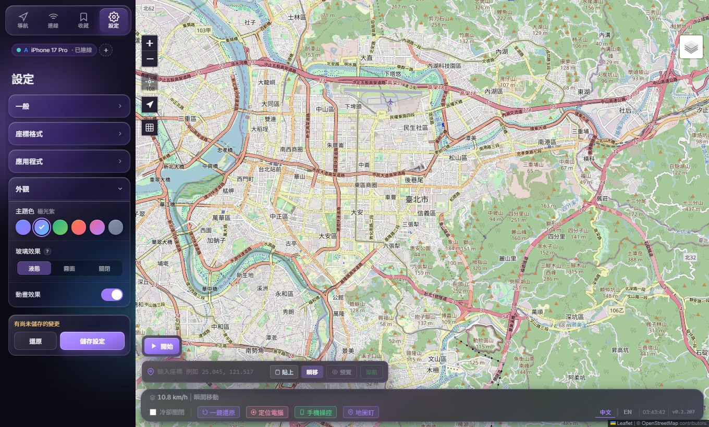

<a id="top"></a>

<p align="center">
  
</p>

<h1 align="center">LocWarp</h1>

<p align="center">
  <b>A virtual location tool that controls iPhone / iPad GPS from Windows</b><br>
  No jailbreak · USB or Wi-Fi · Up to three devices at once · Free and open source
</p>

<p align="center">
  <a href="https://github.com/keezxc1223/locwarp/releases/latest"></a>
  <a href="https://github.com/keezxc1223/locwarp/releases"></a>
  
  
  <a href="LICENSE"></a>
</p>

<p align="center">
  <a href="README.md">繁體中文</a> · <b>English</b>
</p>

<p align="center">
  <a href="#download">Download</a> ·
  <a href="#quick-start">Quick start</a> ·
  <a href="#features">Features</a> ·
  <a href="#troubleshooting">Troubleshooting</a> ·
  <a href="#developer-documentation">Developer docs</a> ·
  <a href="https://lin.ee/UwdCrmf">Contact on LINE</a>
</p>

<p align="center">
  
</p>

> [!WARNING]
> **Before you use it**: LocWarp is meant for research and development testing. Using it with location-based games or services may break their terms of service and get an account restricted or banned. You use it at your own risk. The full terms are in the [Disclaimer](#disclaimer).

## Highlights

- **Six movement modes**: Teleport, navigate, multi-stop routes, flower-farming circles, random walk and joystick, at preset, fixed or randomised speeds.
- **USB and Wi-Fi**: Plug in and it connects. On iOS 17 and later a Wi-Fi Tunnel lets you unplug, and a pinned device reconnects on every launch.
- **Multi-device sync**: Up to three devices at once. Every action is applied to all of them and they walk exactly the same route.
- **Saved coordinates and routes**: Search, categories and drag-and-drop ordering; one click to go. JSON and GPX import and export.
- **Mushroom map**: Shows the mushroom, flower and smoke spots from pipimushroom.com on the map, filterable by size and type, one click to go.
- **Phone web control**: Away from the PC, a phone browser can teleport, navigate, run saved routes, start a random walk, pause and change speed.
- **Coordinate formats**: Switch between WGS84, GCJ02 and BD09 and choose the axis order; display, copy and input stay consistent.
- **In-app updates**: Download a new version inside the app and restart into it. Nothing is downloaded on its own.
- **No sign-up**: Routing, address search and map layers all use free public services. No telemetry.

---

## Screenshots

| Main window and movement modes | Library window | Themes and appearance |
| :---: | :---: | :---: |
|  |  |  |

<details>
<summary>Demo (recorded on an earlier version; the look of the interface has since been updated)</summary>

<p align="center">
  
</p>

</details>

---

## Download

Only a Windows 10 / 11 (64-bit) installer is provided. It contains everything it needs; there is no Python or Node to install.

| Source | Link | Notes |
| --- | --- | --- |
| GitHub Releases | [Latest release](https://github.com/keezxc1223/locwarp/releases/latest) | The main channel, with release notes |
| Google Drive | [Open folder](https://drive.google.com/drive/folders/1bqVnNnSbwrVaf2GT6fEhW6R0ZlhE-fc3) | Same files, for when GitHub is hard to reach |

> [!NOTE]
> The installer is not code-signed. Windows may show a SmartScreen warning, and antivirus software may flag the backend program. If that happens, add the install folder to the exclusion list and install again.

---

## Quick start

1. Download the latest `LocWarp-Setup-x.y.z.exe` from [Releases](https://github.com/keezxc1223/locwarp/releases) and install it.
2. Install iTunes or Apple Devices on the PC. Either one provides the Apple USB driver.
3. Connect the iPhone over USB and tap "Trust This Computer" on the phone.
4. On the iPhone, turn on Settings → Privacy & Security → Developer Mode. If the option is missing, connect in LocWarp and press "Enable Developer Mode" in its Settings tab to make it appear.
5. Launch LocWarp (it asks for administrator rights) and right-click the map to teleport.

Each step is covered in detail under [Installation and setup](#installation-and-setup). If your antivirus quarantines the backend program, add the install folder to its exclusion list and reinstall.

---

## Requirements and compatibility

| Item | Requirement |
| --- | --- |
| PC | Windows 10 / 11 (64-bit) |
| Device | iPhone / iPad. **iOS / iPadOS 17 and later** is the primary supported range |
| iOS 16.x | Community maintained (@bitifyChen, [#9](https://github.com/keezxc1223/locwarp/pull/9)), using the LegacyLocationService path |
| iOS 15 and earlier | Not supported |
| Connection | USB cable, or the same Wi-Fi subnet (Wi-Fi Tunnel is iOS 17+ only) |

### Versions reported working

| Major | Verified versions |
| --- | --- |
| **iOS 27.x** | 27.2.1 · 27.0 (both tested by the developer on iPhone 18 Pro Max) · 27.3 Beta (user report) |
| **iOS 26.x** | 26.5 · 26.4.2 · 26.4.1 · 26.4.1 iPadOS · 26.4 · 26.3.1 · 26.2 · 26.2.1 iPadOS (M1 iPad) |
| **iOS 18.x** | 18.7.8 · 18.7.7 · 18.7.1 · 18.6.2 · 18.5 iPadOS · 18.3.1 · 18.1.1 |
| **iOS 17.x** | 17.6.1 |
| **iOS 16.x** (community) | 16.7.16 · 16.7.15 · 16.7.12 |

"Reported working" means **at least one user ran it successfully in their own environment**. It is not a general compatibility guarantee. Stability depends on the iOS patch version, pymobiledevice3 support for that version, whether the Developer Disk Image is mounted, and the drivers, VPN, firewall, and antivirus setup on the Windows side. An iOS 16+ version missing from the table simply has no report yet. Reports are welcome in [Issues](https://github.com/keezxc1223/locwarp/issues).

---

## Features

Click an item to expand its details.

<details>
<summary><b>Movement modes</b></summary>

| Mode | Description |
| --- | --- |
| **Teleport** | Jump straight to a coordinate |
| **Navigate** | Travel along real roads at walking, cycling, or driving speed from the current position to a destination |
| **Multi-point Route** | Visit waypoints in order, optionally pausing at each stop (random 5 to 20 seconds by default). Laps: 0 runs the route once, N runs N laps, blank loops forever |
| **Flower Farmer** | Circle around each waypoint. Radius, segments per circle (3 to 20), circles per point (0.5 is a half circle), total rounds, and the wait before and after each point are all adjustable and saved. Travel between points by walking or teleporting. The panel shows a live estimate of the total run time, and a dropped connection reconnects and resumes on its own |
| **Random Walk** | Wander randomly inside a radius, with adjustable pauses between legs |
| **Joystick** | Steer live by direction and intensity. WASD and arrow keys are supported |

Multi-point Route has a **point-to-point jump** option that teleports from waypoint to waypoint instead of following roads, for cases where the GPS only needs to sit at each point in turn. The delay before each jump (default 2 seconds) and after it (default 4 seconds) are adjustable, and both freeze while paused.

</details>

<details>
<summary><b>Speed control</b></summary>

- Three presets: walking 10.8, cycling 19.8, driving 60 km/h.
- Enter any fixed speed, or a min to max range (for example 40 to 80 km/h) that is re-rolled for every leg to mimic real traffic.
- Change the speed while moving and press "Apply new speed". Movement continues from the current position at the new speed, with no restart.
- The last speed you picked is remembered for the next launch. A countdown banner appears above the map while paused at a stop.

</details>

<details>
<summary><b>Routing source</b></summary>

The road routes used by Navigate and Multi-point Route can come from any of four free, no-signup routing engines:

| Engine | Notes |
| --- | --- |
| **OSRM public demo** (default) | Global coverage, occasionally goes down entirely |
| **OSRM FOSSGIS** | The same OSRM engine on a mirror hosted by FOSSGIS |
| **Valhalla** | A completely different engine, most useful when both OSRM nodes are down |
| **BRouter** | An independently run fourth engine with cycling, hiking, and driving profiles |

When an engine fails, that leg falls back to a straight line and the next leg tries the engine again, so a run never stalls. You can also tick "Use straight-line path" to skip the engines altogether. Multi-point Route has an "optimal order" button that finds the shortest visiting order.

</details>

<details>
<summary><b>Connection</b></summary>

- **USB**: connects automatically when plugged in, and locking the iPhone screen has no effect. Unplugging is detected within about 4 seconds, and plugging back in recovers without a refresh.
- **Wi-Fi Tunnel** (iOS 17+, requires one prior USB pairing):
  - **Scan WiFi devices** on the Connection page finds iPhones on the same Wi-Fi and connects the ones that are not connected yet; connected devices are left alone. It looks over mDNS first, then scans the local network, and only counts devices confirmed to be iPhones.
  - "Auto-detect" inside the Wi-Fi panel only lists what it finds and leaves the choice to you.
  - Auto-connect at startup fills the remaining device slots (three at most): with one device already connected (for example over USB), the others still connect by themselves. It uses only mDNS and previously connected IPs and never scans the local network in the background.
  - Devices connecting at the same time do not wait for each other, so one that fails does not slow the rest.
  - Previously used IPs are remembered. You can also pin a device so that it connects on every launch and retries after a drop. Once any device is pinned, only pinned devices auto-connect on launch; the connection page points it out when the device in use is not pinned.
  - "Keep connection alive when the screen dims" (experimental) keeps re-sending the position to reduce drops after the iPhone locks.
  - "Re-pair" rebuilds a damaged pairing record over USB in one click.
  - Stopping the tunnel while USB is still plugged in switches back to USB automatically.

</details>

<details>
<summary><b>Multi-device group mode</b></summary>

Connect **up to three** devices at once. Teleport, Navigate, every movement mode, pause, resume, stop, apply speed, and restore are sent to all devices together, from both the desktop UI and the phone web control.

- Before any action starts, all devices are teleported to the same coordinate so their paths match.
- Random Walk shares one random seed, so every device walks the same route.
- With a speed range or random pauses, every device draws the same speed and pause length, so they do not drift apart.
- While moving, the progress bar lists each device's own estimated arrival time as A / B / C.
- A device plugged in later syncs to the current position and joins the task already running.
- Each device can be restored, disconnected, or have its Developer Mode option revealed on its own.

</details>

<details>
<summary><b>Map</b></summary>

- **Layer switcher** (top right): OSM, Google Tiles (Beta), ESRI Street Map, ESRI Satellite, OpenFreeMap Liberty / Bright / Positron (vector), VersaTiles Colorful, NLSC (Taiwan), GSI (Japan). None of them need an API key.
- Waypoints are labelled S / 1 / 2 / 3, and the route line has flowing arrows that show direction.
- The top-left button recentres the map on the current simulated position. In "show route only" view the map zooms to fit the whole route.
- The map marker can be swapped for one of six built-in characters or your own PNG (transparent borders are trimmed automatically).
- **Coordinate format** (Settings): the coordinate system can be WGS84 / CGCS2000 (default), GCJ02 (Amap, Tencent) or BD09 (Baidu), and the axis order can be latitude first or longitude first. The setting applies to coordinates that are shown, copied and typed in, and phone web control follows it. The map, saved coordinates and routes, GPX and backup files always stay in WGS84. GCJ02 is only offset in mainland China, Hong Kong and Macau; BD09 additionally covers Taiwan; elsewhere both equal WGS84.

</details>

<details>
<summary><b>Library window</b></summary>

"Library" in the top navigation opens a draggable floating window with two tabs, Coordinates and Routes, that work the same way:

- The search box stays at the top. One click on a coordinate moves the GPS; one click on a route loads it.
- Right-click an item, or press the "..." at the end of its row, for the same menu: rename, edit, copy, export, move to category, delete. Category headers have a right-click menu too: rename, colour, export, delete.
- Ctrl-click or Shift-click selects several items, which can then be moved or deleted together.
- Drag an item to reorder it, or onto another category to move it there. Categories can be dragged into a new order as well.
- Sort manually, by name, by date added, or by last used (last updated for routes).

</details>

<details>
<summary><b>Saved coordinates</b></summary>

- "Add" saves the current position, adds an entry from typed coordinates, bulk-pastes many coordinates, or imports a file. New entries pick up a country flag automatically.
- After deleting a coordinate, an Undo offer appears at the bottom of the window.
- Import and export: JSON (everything, imports merge rather than overwrite) and GPX (a single entry, a whole category, or several categories as one ZIP).
- Show every saved coordinate on the map. Tens of thousands stay smooth, and dense areas cluster automatically.
- With "Clicking a coordinate moves GPS" turned off, a click only pans the map and the GPS stays put.

</details>

<details>
<summary><b>Saved routes</b></summary>

- "Add" saves the route currently on the map. If the name already exists you can overwrite it or save a new one.
- GPX and JSON import and export.
- Copy the waypoints in their current order as coordinate text, one per line.

</details>

<details>
<summary><b>Mushroom map</b></summary>

Shows the mushroom, flower and smoke spots from [pipimushroom.com](https://pipimushroom.com/) on the map (Taiwan, Hong Kong and Malaysia at the moment). Press the mushroom button in the toolbar on the left of the map to open its panel. The panel can be dragged by its title and folded down to the title alone.

- Mushrooms, flowers and smoke can be switched on and off separately.
- **Mushroom filters** (click to expand): filter by size, type and minimum time left. The choices come from the loaded data, and each group has Select all and None.
- Flowers can be narrowed to ribbon flowers only, or common flowers can be hidden. Ribbon flowers get a rainbow ring and show how long the ribbon period has left.
- Markers come in three sizes. Open one to see the time remaining and to teleport or navigate there.
- Data loads from zoom 15 upward; when the map is too far out, a notice above the map tells you to zoom in. The same view is not fetched again within 60 seconds, and requests to the site are at least 1 second apart.

**Logging in**: the site only serves data to logged-in users. **How to log in** in the panel opens the steps. There are two ways:

1. **Chrome extension (recommended)**: install [LocWarp Mushroom Map Cookie Sync](https://chromewebstore.google.com/detail/gdnekjckhabkheedihakapkcnnilikjb) from the Chrome Web Store (Open store in the guide opens the same page), then log in to pipimushroom.com in the same Chrome. If you would rather not use the store, the same extension ships with the app in `resources\extensions\pipi-cookie-sync` under the install folder: go to `chrome://extensions` in Chrome, turn on Developer mode, press Load unpacked and pick that folder. Use one of the two, not both. The login syncs by itself. The site's login expires after about 15 minutes without use; LocWarp while it is running, and the extension, both renew it on a timer. If it still expires (after the PC sleeps, for example), the panel shows Login expired, and logging in again on the site in Chrome restores it within about a minute.
2. **Paste the cookie by hand**: without Chrome, copy the cookie from your browser as the guide describes and paste it in.

LocWarp never handles your Google password. The login data stays on this PC (`~/.locwarp/settings.json`) and is only ever sent to pipimushroom.com. The extension's privacy notes are in [docs/pipi-extension-privacy.md](docs/pipi-extension-privacy.md).

> Data source: pipimushroom.com. Position, type and time left are not guaranteed to be accurate and are for reference only. If that site changes, this layer may stop working for a while.

</details>

<details>
<summary><b>Address search</b></summary>

- **Free**: the default provider, built on OpenStreetMap open data, no API key needed. A Photon option in the settings offers stronger fuzzy matching and typo tolerance.
- **Google Geocoding**: enter your own API key (stored only on your machine) for the most accurate results on Chinese place names and businesses. There is a free monthly quota.
- The coordinate box accepts pasted coordinate text and picks out the valid latitude and longitude.
- The phone web control follows the provider chosen on the desktop.

</details>

<details>
<summary><b>Phone web control</b></summary>

Control LocWarp from a phone browser when you are away from the PC. The "Phone control" button in the status bar shows a LAN address and a 6-digit PIN. Enter them on the phone to get a mobile map with teleport, navigate to a point (walk / bike / drive or a custom speed), address search, coordinate input, stop, and restore, plus a live view of the route running on the desktop. While moving it shows progress, remaining distance and time, and lets you pause, resume or change the speed. The coordinates saved on the PC and the recent list (50 entries) are available directly. The page can be added to the phone's home screen to open full screen like an app, and it follows the desktop's theme colour and coordinate format.

- **Routes**: pick a route saved on the PC. The map previews it first, then you choose where to start (teleport to the start, or walk there from the current position) and how to run it: once, looping, or in Flower Farmer mode, circling every waypoint.
- **Random walk**: centred on the current position; set the radius and the speed, then start.
- **Locate PC**: finds where the PC really is (Windows Location, falling back to IP geolocation) and marks it on the map, where you can teleport or navigate to it.
- **Map layer**: the layer button at the bottom right of the map switches the base map, with the same choices as the desktop. By default it follows the layer the desktop is showing; a layer picked on the phone takes over from then on.

> The phone must be on the **same Wi-Fi** as the PC, and the PC firewall must allow port 8777. "Regenerate" issues a new PIN at once and invalidates phones paired earlier. Five wrong PINs in a row lock entry for 60 seconds.

</details>

<details>
<summary><b>Status bar</b></summary>

- **Country flag, place name, local weather, and temperature** for the current simulated position.
- A time difference indicator after crossing time zones. Click it for full time zone details.
- **Restore**: clears the simulated location. Note that "Stop" only ends the movement and keeps the simulated location in place. Press Restore to return to the real GPS.
- Version number, with a `NEW` badge when an update is available. Click it and press Download update to fetch the new version inside the app with a progress bar, then press Restart to switch to it. You can also get the installer yourself from GitHub or Google Drive. Nothing is downloaded until you ask for it.
- "Log folder" button: opens `~/.locwarp/logs/` so you can attach backend.log to an issue.

</details>

<details>
<summary><b>Other</b></summary>

- **Cooldown**: a cooldown based on teleport distance, to lower the risk of being flagged for impossible movement.
- The interface switches between Traditional Chinese and English on the fly.
- **Appearance** (Settings): six theme colours, three glass styles (Liquid / Frosted / Off) and an animation switch. If the window stutters, set the glass style to Frosted or Off.
- Changes to appearance, coordinate format and the alert sound on the Settings page are kept only after pressing Save settings.
- Route completion sound, and a hardware acceleration switch (turning it off fixes ghosting or a black window on some GPU drivers, see [Issue #24](https://github.com/keezxc1223/locwarp/issues/24)).
- All data (saved coordinates, routes, settings) lives in `~/.locwarp/` and survives a reinstall.

</details>

---

## Installation and setup

**[Download the installer](https://github.com/keezxc1223/locwarp/releases)**. It bundles everything, so there is no need to install Python or Node. After installing, launch **LocWarp** from the desktop or Start menu. It asks for administrator rights, which the Wi-Fi Tunnel needs in order to create a virtual network interface.

### 1. Install the Apple USB driver

Windows needs Apple's USB driver to talk to an iPhone. Install **any one** of these:

- [iTunes for Windows (desktop, 64-bit)](https://secure-appldnld.apple.com/itunes12/047-76416-20260302-fefe4356-211d-4da1-8bc4-058eb36ea803/iTunes64Setup.exe)
- [iTunes from the Microsoft Store](https://apps.microsoft.com/detail/9pb2mz1zmb1s)
- [Apple Devices from the Microsoft Store](https://apps.microsoft.com/detail/9np83lwlpz9k)

Desktop iTunes works for most people. If iTunes cannot see the iPhone, users have reported that Apple Devices does.

### 2. Connect over USB and trust the computer

Before first use, connect the iPhone with a USB cable. The phone asks "Trust This Computer?". Tap **Trust** and enter your passcode.

### 3. Turn on Developer Mode

On the iPhone: **Settings → Privacy & Security → Developer Mode → On**. The device asks to restart, then asks you to confirm once more.

On iOS 16 and later this option is hidden by default. Once LocWarp is connected, open the **Settings** tab at the top and press "**Enable Developer Mode**". After pressing it:

1. Fully close the Settings app on the iPhone.
2. Reopen Settings → Privacy & Security and scroll down to find Developer Mode.
3. Turn it on and restart when asked.

If the button does not work (for example on a Wi-Fi only connection), use the [IPA sideloading fallback](#appendix-revealing-developer-mode-by-sideloading).

### 4. Mount the Developer Disk Image (iOS 17+)

iOS 17 and later need a Personalized DDI mounted on the iPhone before the location can be simulated. LocWarp only checks for it and never downloads or mounts it. If you see "No DDI detected on the iPhone", mount it once with any of these tools: Xcode, i4Tools, 3uTools, or the pymobiledevice3 CLI.

### 5. Wi-Fi Tunnel (optional)

To unplug USB and go wireless:

- The iPhone and the PC must be on the **same Wi-Fi subnet**.
- The USB pairing from step 2 must already be done.
- Start the Wi-Fi Tunnel from the Connection tab in LocWarp. Once it is up, USB can be unplugged.

| Connection | iPhone screen lock | Recommendation |
| --- | --- | --- |
| **USB** | No effect | None |
| **Wi-Fi Tunnel** | Puts the network interface to sleep and drops the connection | Turn off Auto-Lock, or enable "Keep connection alive when the screen dims" |

With the Wi-Fi Tunnel, set Settings → Display & Brightness → Auto-Lock to **Never** and keep the phone on a charger.

---

## Updating

When a new version is out, a `NEW` badge appears next to the version number at the bottom right. Click it, then:

1. Press **Download update**. The app downloads in the background and shows progress.
2. When it finishes, press **Restart**. The app reopens on the new version with your coordinates and settings intact.

Nothing is downloaded until you ask for it. You can also get the installer yourself from the GitHub or Google Drive links in the same dialog and install over the old version. Versions up to v0.2.205 have no in-app update and need one manual install.

---

## Troubleshooting

| Symptom | Likely cause and fix |
| --- | --- |
| A dialog says the backend program is missing | Antivirus quarantined the unsigned backend exe. Add the install folder to the exclusion list and reinstall |
| The tunnel starts but nothing connects | Make sure LocWarp runs as administrator, and try again with VPN or third-party firewall software turned off |
| Wi-Fi has to be connected by hand on every launch | On the Connection page, check whether this device is pinned. Once any other device is pinned, only pinned devices auto-connect on launch |
| The mushroom map shows no spots | Check in order: the panel says Logged in (otherwise press How to log in), the map is at zoom 15 or closer, and the location is in Taiwan, Hong Kong or Malaysia. When the panel shows Login expired, open the site in Chrome and log in again; the extension syncs by itself. A cookie pasted by hand has to be pasted again once it expires |
| Wi-Fi auto-detect finds no device | Check that both are on the same Wi-Fi subnet and that the router has no client or AP isolation. Entering the IP by hand also works |
| The port scan says the IP answers on every port | A VPN or proxy is intercepting connections. Turn it off and retry. Auto-detect may also find nothing while a VPN is on |
| `No such service: com.apple.instruments.dtservicehub`, or "No DDI detected" | Mount the DDI as described in [step 4](#4-mount-the-developer-disk-image-ios-17). If it still fails, turn Developer Mode off, reboot, turn it back on, and mount again |
| Developer Mode is missing from the iPhone Settings | With the device connected, open the Settings tab at the top of LocWarp and press "Enable Developer Mode", then close and reopen the iPhone Settings app as described in [step 3](#3-turn-on-developer-mode). If the button does not work, use the [sideloading fallback](#appendix-revealing-developer-mode-by-sideloading) |
| Ghosting or a black window | Turn off hardware acceleration in the Settings tab |
| App crashes right at launch | Newer builds fall back to software rendering and relaunch on their own; if it still crashes, right-click the shortcut › Properties › Target and append `--no-sandbox --disable-gpu --in-process-gpu` |
| The flag or place name does not appear | Both come from free public services that are sometimes briefly unresponsive. Teleport again a little later |

When reporting a problem, include the iOS version, the connection type, and `~/.locwarp/logs/backend.log`.

### Appendix: Revealing Developer Mode by sideloading

1. Install [Sideloadly](https://sideloadly.io/).
2. Get any IPA from [Decrypt IPA Store](https://decrypt.day/) or [ARM Converter Decrypted App Store](https://armconverter.com/decryptedappstore/us). A small one keeps the sideload short.
3. Drag the IPA into Sideloadly, connect the iPhone over USB, enter your personal Apple ID, and press **Start**.
4. When it finishes, Developer Mode appears at the bottom of Settings → Privacy & Security. Turn it on and restart.

---

## Developer documentation

<details>
<summary>Expand the developer docs (architecture, stack, development setup, building, project layout)</summary>

### Architecture

```
┌─────────────────┐      IPC / HTTP + WS       ┌──────────────────┐
│ Electron + React│ ─────────────────────────► │ FastAPI backend  │
│  (port 5173 dev)│ ◄───────────────────────── │  (port 8777)     │
└─────────────────┘                            └────────┬─────────┘
                                                        │ pymobiledevice3
                                                        ▼
                                              ┌──────────────────┐
                                              │ iPhone (USB/WiFi)│
                                              └──────────────────┘
```

### Stack

| Layer | Technology | Purpose |
| --- | --- | --- |
| Frontend | [Electron](https://www.electronjs.org/) 45 | Desktop shell: windows, spawning the backend, rewriting the User-Agent on tile requests |
| Frontend | [electron-updater](https://www.electron.build/auto-update) | In-app update, downloading from GitHub Releases |
| Frontend | [React](https://react.dev/) 19 + [TypeScript](https://www.typescriptlang.org/) 7 + [Vite](https://vitejs.dev/) 8 | UI and bundling (`base: './'` for `file://` loading) |
| Frontend | [Leaflet](https://leafletjs.com/) 1.9 | Interactive map, custom markers, animated route lines |
| Frontend | [MapLibre GL](https://maplibre.org/) 6 | Vector layer rendering, attached to Leaflet through maplibre-gl-leaflet |
| Backend | Python 3.13 + [FastAPI](https://fastapi.tiangolo.com/) + [uvicorn](https://www.uvicorn.org/) | REST API and WebSocket (`:8777`) |
| Backend | [pymobiledevice3](https://github.com/doronz88/pymobiledevice3) 11.50+ | iOS device protocols (DVT / RemoteServices / lockdown / LegacyLocationService) and the Wi-Fi tunnel |
| Backend | [httpx](https://www.python-httpx.org/), [pydantic](https://docs.pydantic.dev/), [gpxpy](https://github.com/tkrajina/gpxpy) | External service calls, validation, GPX parsing |
| Packaging | [PyInstaller](https://pyinstaller.org/), [electron-builder](https://www.electron.build/) (NSIS) | Backend exe and the Windows installer |

All icons are inline SVG and the styling is hand-written CSS (`styles.css` for layout, `appearance.css` for themes, glass and motion, `library.css` for the library window). No third-party icon or UI kit is used.

### External services

All free. Only Google Geocoding needs a key, which the user supplies. Nothing else needs a signup.

| Service | Called from | Purpose |
| --- | --- | --- |
| [OSRM demo](https://project-osrm.org/), [OSRM FOSSGIS](https://routing.openstreetmap.de/), [Valhalla](https://valhalla1.openstreetmap.de/), [BRouter](https://brouter.de/) | backend | Routing and waypoint order optimisation |
| [Photon (komoot)](https://photon.komoot.io/) | backend | Address search and reverse geocoding (flag, place name) |
| [Google Geocoding API](https://developers.google.com/maps/documentation/geocoding) | backend | Address search (optional, user-supplied key) |
| [Open-Meteo](https://open-meteo.com/) | frontend | Weather at the simulated position |
| [TimezoneDB](https://timezonedb.com/) | backend | Coordinate to time zone (built-in key) |
| [flagcdn.com](https://flagcdn.com/) | frontend | Flag images |
| OpenStreetMap, Google, [ESRI](https://www.esri.com/), [OpenFreeMap](https://openfreemap.org/), [VersaTiles](https://versatiles.org/), [NLSC](https://maps.nlsc.gov.tw/), [GSI](https://www.gsi.go.jp/) | frontend | Map tiles |
| [pipimushroom.com](https://pipimushroom.com/) | backend | Spot data for the mushroom map layer (optional, needs the user's own login) |
| [GitHub Releases](https://github.com/keezxc1223/locwarp/releases) | frontend | Update check at launch (no telemetry); the new version is downloaded only after the user presses Download update |

Reverse geocoding does not use the public Nominatim server. Its usage policy counts traffic per application, which does not suit a distributed desktop app. If the default address search option is refused by Nominatim, it falls back to Photon automatically.

### Core modules (`backend/core/`)

| Module | Responsibility |
| --- | --- |
| `simulation_engine.py` | Central controller: state transitions, task lifecycle, the `_move_along_route()` movement loop, ETA tracking |
| `device_manager.py` | Device discovery, USB and Wi-Fi Tunnel connection management |
| `navigator.py` | Single-destination navigation |
| `route_loop.py` / `multi_stop.py` | Looping and stopping for Multi-point Route |
| `flower.py` | Circling logic for Flower Farmer |
| `random_walk.py` / `joystick.py` | Random Walk, Joystick |
| `teleport.py` / `restore.py` | Teleport, restore |

### Design notes

- **Position push**: the backend emits `position_update` over WebSocket on every tick, and the frontend updates the map and ETA live.
- **Speed resolution**: `config.resolve_speed_profile()` handles mode preset, fixed speed, and random range in one place, with priority range > fixed > preset.
- **In-process Wi-Fi tunnel**: the backend runs `start_tcp_tunnel()` inside its main event loop. There is no separate helper process.
- **State directory**: all runtime data goes to `~/.locwarp/`, avoiding PyInstaller's temporary directory.
- **Restrained geo lookups**: flag, place name, time zone, and weather are looked up only while idle or after a teleport, and only after moving more than 100 m. Nothing is looked up during movement, so it never competes with device traffic. The four lookups run in parallel, so one slow service does not hold up the rest.
- **Reverse geocode cache**: results are stored on disk per cell of roughly 100 m (`reverse_geocode_cache.json`, kept 30 days). Returning to a place already looked up costs no request, and identical lookups fired at the same moment share one request. Adding a coordinate and "What's here" bypass the cache to get an exact name.
- **Weather straight from the frontend**: each user spends their own Open-Meteo quota by IP rather than going through the backend.
- **Layer preconnect**: hovering the layer picker opens connections to every layer's host and fetches the vector styles, which shortens the wait on the first switch.
- **Multi-device group**: the primary device is never displaced by one plugged in later. The newcomer syncs to the primary's position and joins its task.

### Development setup

Requirements: Windows 10 / 11, Python **3.13**, Node.js 18+, and an iPhone that is paired with Developer Mode on.

```bash
# Backend dependencies (including the Wi-Fi tunnel)
py -3.13 -m pip install -r backend/requirements.txt

# Frontend dependencies
cd frontend
npm install
```

Double-clicking `LocWarp.bat` elevates itself and starts the backend (`:8777`) and the Vite dev server (`:5173`), then opens the default browser. To start things by hand:

```bash
# Terminal 1: backend
cd backend && py -3.13 main.py

# Terminal 2a: frontend in the browser
cd frontend && npx vite --host --port 5173

# Terminal 2b: frontend in an Electron window (same as the installed app)
cd frontend && npm run start
```

> Dev mode runs on `http://` and the installed app on `file://`, and the two do not behave identically (the MapLibre worker, for one). After upgrading frontend dependencies, always verify with a packaged installer.

### Building the installer

```bash
# One-time setup
py -3.13 -m pip install pyinstaller
cd frontend && npm install -D electron-builder

# One-shot build
build-installer.bat
```

`build-installer.bat` runs, in order:

1. **PyInstaller** builds the backend into `dist-py/locwarp-backend/`
2. **Vite** builds the frontend into `frontend/dist/`
3. **electron-builder** produces `frontend/release/LocWarp-Setup-X.Y.Z.exe` (about 150 MB)

Note that `npm run dist` only runs step 3. Re-run PyInstaller after changing the backend, and re-run `npx vite build` after changing the frontend or the version number. Otherwise the installer ships stale content.

When publishing a release, upload all three files from `frontend/release/` to the GitHub release: `LocWarp-Setup-X.Y.Z.exe`, `LocWarp-Setup-X.Y.Z.exe.blockmap` and `latest.yml`. The in-app update reads `latest.yml` to learn the latest version, and the `.blockmap` lets it download only what changed. Without `latest.yml`, users can only download manually.

### Project layout

```
locwarp/
├── backend/                 # FastAPI + pymobiledevice3
│   ├── api/                 # HTTP endpoints
│   ├── core/                # Simulation engine + movement modes
│   ├── services/            # Location service, geocoding, saved coordinates, routes
│   ├── models/schemas.py    # Pydantic models
│   ├── static/phone.html    # Phone web control page
│   ├── config.py            # Speed profiles, cooldown table, paths
│   ├── main.py              # Entrypoint
│   └── locwarp-backend.spec # PyInstaller spec
│
├── frontend/                # Electron + React
│   ├── electron/main.js     # Electron entry, spawns the backend when packaged
│   ├── src/
│   │   ├── App.tsx
│   │   ├── components/      # MapView, ControlPanel, LibraryPanel, StatusBar...
│   │   ├── hooks/           # useSimulation, useDevice, useBookmarks
│   │   ├── i18n/            # Chinese and English strings
│   │   └── services/api.ts
│   ├── build/               # Icons and installer artwork
│   └── package.json         # electron-builder config
│
├── LocWarp.bat / start.py   # Dev launcher (auto-elevates)
├── stop.py
├── extensions/              # Chrome extension for the mushroom map; pack.py builds the store upload zip
└── build-installer.bat      # One-shot installer build
```

</details>

---

## Support and contact

For questions, suggestions, or to report an iOS version as working, [add the author on LINE](https://lin.ee/UwdCrmf) or open an [Issue](https://github.com/keezxc1223/locwarp/issues).

### USDT tip jar (TRC-20 / TRON network)

LocWarp is free and open source. If you would like to support development, the address is below. **TRC-20 (TRON network) only.** Do not send over any other network.

```
TTLi4YcPcDw5R8Mr4H4u5rDuFwTZjtCQXk
```

<p>
  
</p>

---

## Acknowledgements

LocWarp is built on these open-source projects and public services:

- [pymobiledevice3](https://github.com/doronz88/pymobiledevice3): every protocol used to talk to iOS devices
- [Leaflet](https://leafletjs.com/) and [MapLibre GL](https://maplibre.org/): map rendering
- [OpenStreetMap](https://www.openstreetmap.org/copyright) contributors: map data
- [OSRM](https://project-osrm.org/), [Valhalla](https://github.com/valhalla/valhalla) and [BRouter](https://brouter.de/): routing
- [Photon](https://photon.komoot.io/) and [Open-Meteo](https://open-meteo.com/): address search and weather
- [Mushroom map (pipimushroom.com)](https://pipimushroom.com/): spot data for the mushroom map layer
- Everyone who reported issues, tested iOS versions and contributed code

---

## About this project

LocWarp is an open-source project maintained by one person. It is not a commercial product and has no dedicated team. The developer will do their best to add features, answer issues, fix bugs, and keep up with iOS and pymobiledevice3 releases within a reasonable time. However:

- The project is only guaranteed to work in **the developer's own test environment** (currently iPhone 18 Pro Max / iOS 27.2.1 + Windows 11 Pro);
- It is **not guaranteed to run reliably on other devices, iOS patch versions, networks, or system configurations**;
- If you run into a problem, please open an [Issue](https://github.com/keezxc1223/locwarp/issues) with full environment details and logs to help track it down;
- Ongoing maintenance is not guaranteed, and no liability is accepted for anything arising from use of this tool.

---

## License

Released under the **MIT License**. See [LICENSE](LICENSE).

You may use, modify, redistribute, and use it commercially, provided the original copyright and licence notice are kept.

---

## Disclaimer

### 1. Academic and research use only

This project is intended for geographic information system (GIS) research, mobile application development and testing, location service prototyping, and related technical study. Do not use it for anything illegal, or in any way that violates third-party terms of service or platform policies.

### 2. Risk of account bans

This project talks to Apple's DVT / RemoteServices protocols through pymobiledevice3 to simulate GPS signals. Using it with location-based games (such as Pokémon GO, Ingress, or Monster Hunter Now) or with social, check-in, or logistics apps may violate those platforms' terms of service and lead to warnings, restrictions, suspension, or a permanent ban. **The developer accepts no responsibility for any account loss, virtual property damage, or resulting dispute.**

### 3. System and hardware risk

In Wi-Fi Tunnel mode this project must run with **administrator rights** to create a TUN virtual network interface and negotiate an RSD (Remote Service Discovery) channel with the iOS device. The code has been tested internally, but the developer does not guarantee stable operation on every Windows version, hardware combination, or network. Known possibilities include:

- Conflicts with VPN software, third-party firewalls, or network virtualisation tools that stop the tunnel from forming or briefly disrupt networking
- A leftover TUN interface after an abnormal exit that needs a reboot to clear
- Having to retry by hand or restart the app after a dropped connection

You are responsible for weighing these risks and for any consequences. The project only touches the temporary network interface it creates and its own settings under `~/.locwarp/`. **It does not modify any user data on the iOS device, and does not change operating system files or existing device pairing records.**

### 4. Map data accuracy

The frontend uses Leaflet with base maps from OpenStreetMap and other third-party tile providers. Routing uses the public OSRM, Valhalla, and BRouter services, and geocoding uses public services such as Photon. Coordinates, routes, and addresses shown on the map are **for reference only**. The developer does not guarantee that they are complete, current, correct, or an exact match for real-world geography. Before relying on address search, navigation, or random walk results for a simulation, check that what the map shows is what you expect.

### 5. User responsibility

You are responsible for complying with the laws and regulations where you live, including but not limited to personal data protection law, copyright law, and applicable international treaties. Any legal dispute, civil liability, or criminal liability arising from abuse, misuse, or unlawful use of this tool rests with the user alone and does not involve the developers or contributors of this project.

---

**By downloading, installing, or running this software, you confirm that you have read and agree to all of the terms above.**

**If you do not agree, stop using the software and remove it at once.**

---

<p align="right"><a href="#top">Back to top</a></p>
