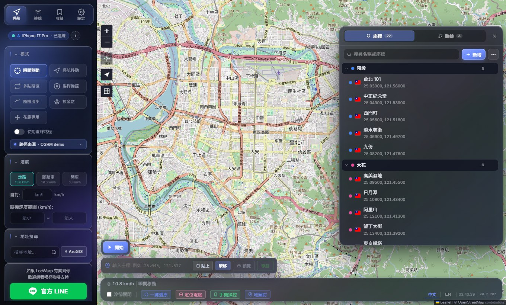
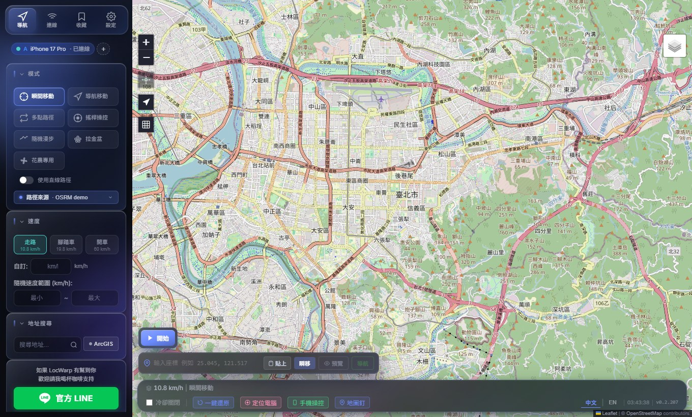
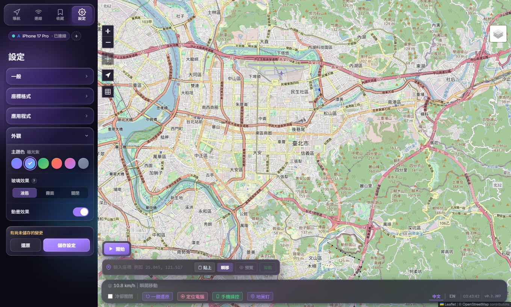

<a id="top"></a>

<p align="center">
  
</p>

<h1 align="center">LocWarp</h1>

<p align="center">
  <b>在 Windows 上控制 iPhone / iPad GPS 定位的虛擬定位工具</b><br>
  免越獄 · USB 或 WiFi 連線 · 最多同時三台裝置 · 免費開源
</p>

<p align="center">
  <a href="https://github.com/keezxc1223/locwarp/releases/latest"></a>
  <a href="https://github.com/keezxc1223/locwarp/releases"></a>
  
  
  <a href="LICENSE"></a>
</p>

<p align="center">
  <b>繁體中文</b> · <a href="README.en.md">English</a>
</p>

<p align="center">
  <a href="#下載">下載</a> ·
  <a href="#快速開始">快速開始</a> ·
  <a href="#功能">功能</a> ·
  <a href="#疑難排解">疑難排解</a> ·
  <a href="#開發者文件">開發者文件</a> ·
  <a href="https://lin.ee/UwdCrmf">LINE 聯絡作者</a>
</p>

<p align="center">
  
</p>

> [!WARNING]
> **使用前請注意**:LocWarp 僅供研究與開發測試。用在以位置為基礎的遊戲或服務可能違反該平台的服務條款,並導致帳號受限或停權,風險由使用者自行承擔。完整條款見[免責聲明](#disclaimer免責聲明)。

## 特色

- **六種移動模式**:瞬移、導航、多點路徑、花農專用、隨機漫步、搖桿,速度可用預設檔位、固定值或隨機範圍。
- **USB 與 WiFi**:插上 USB 自動連線;iOS 17 以上可改用 WiFi Tunnel 拔線使用,釘選後每次啟動自動連上。
- **多裝置同步**:最多三台裝置同時操作,所有動作同步套用,走的路線完全相同。
- **座標與路線收藏**:搜尋、分類、拖曳排序,單擊即移動;支援 JSON 與 GPX 匯入匯出。
- **蘑菇地圖**:在地圖上顯示 pipimushroom.com 的蘑菇、花與煙霧點位,可依大小與種類篩選,點一下就能過去。
- **手機網頁操控**:人不在電腦旁時,用手機瀏覽器就能瞬移、導航、暫停與變速。
- **座標格式**:WGS84、GCJ02、BD09 與經緯度順序可切換,顯示、複製、輸入一致。
- **程式內更新**:有新版時在程式內下載並重新啟動即可,不會自動下載。
- **不需要註冊**:路線規劃、地址搜尋、地圖圖層全部使用免費的公共服務,無遙測。

---

## 介面預覽

| 主畫面與移動模式 | 收藏視窗 | 主題與外觀設定 |
| :---: | :---: | :---: |
|  |  |  |

<details>
<summary>操作示範(錄製於較早的版本,介面外觀已更新)</summary>

<p align="center">
  
</p>

</details>

---

## 下載

目前只提供 Windows 10 / 11(64 位元)安裝檔。安裝檔已包含所有需要的元件,不用另外安裝 Python 或 Node。

| 來源 | 連結 | 說明 |
| --- | --- | --- |
| GitHub Releases | [下載最新版](https://github.com/keezxc1223/locwarp/releases/latest) | 主要發布位置,附更新內容 |
| Google 雲端 | [開啟資料夾](https://drive.google.com/drive/folders/1bqVnNnSbwrVaf2GT6fEhW6R0ZlhE-fc3) | 內容相同,連不上 GitHub 時使用 |

> [!NOTE]
> 安裝檔沒有數位簽章,Windows 可能顯示 SmartScreen 警告,防毒軟體也可能誤判後端程式。遇到時請把安裝資料夾加入排除清單後重新安裝。

---

## 快速開始

1. 到 [Releases](https://github.com/keezxc1223/locwarp/releases) 下載最新的 `LocWarp-Setup-x.y.z.exe` 並安裝。
2. 電腦安裝 iTunes 或 Apple Devices(提供 Apple USB driver)。
3. 用 USB 線接上 iPhone,在 iPhone 上點「信任這部電腦」。
4. iPhone 開啟「設定 → 隱私權與安全性 → 開發者模式」。找不到這個選項時,LocWarp 連線後到「設定」頁按「開啟開發者模式」就會出現。
5. 開啟 LocWarp(會要求系統管理員權限),在地圖上按右鍵即可瞬移。

每個步驟的細節見[安裝與前置設定](#安裝與前置設定)。防毒軟體若把後端程式誤判隔離,請先把安裝資料夾加入排除清單再重新安裝。

---

## 系統需求與相容性

| 項目 | 需求 |
| --- | --- |
| 電腦 | Windows 10 / 11(64 位元) |
| 裝置 | iPhone / iPad,**iOS / iPadOS 17 以上**為主要支援版本 |
| iOS 16.x | 由社群維護(@bitifyChen,[#9](https://github.com/keezxc1223/locwarp/pull/9)),走 LegacyLocationService 路徑 |
| iOS 15 以下 | 不支援 |
| 連線 | USB 線,或同一個 WiFi 網段(WiFi Tunnel 僅 iOS 17+) |

### 已回報可用的版本

| 主版本 | 已驗證版本 |
| --- | --- |
| **iOS 27.x** | 27.0(開發者實測,iPhone 18 Pro Max) · 27.3 Beta(使用者回報) |
| **iOS 26.x** | 26.5 · 26.4.2 · 26.4.1 · 26.4.1 iPadOS · 26.4 · 26.3.1 · 26.2 · 26.2.1 iPadOS (M1 iPad) |
| **iOS 18.x** | 18.7.8 · 18.7.7 · 18.7.1 · 18.6.2 · 18.5 iPadOS · 18.3.1 · 18.1.1 |
| **iOS 17.x** | 17.6.1 |
| **iOS 16.x**(社群維護) | 16.7.15 · 16.7.12 |

「回報可用」代表**至少一位使用者在其環境下成功運作**,不等同於通用相容性保證。虛擬定位的穩定性取決於 iOS 修補版本、pymobiledevice3 對該版本的支援、Developer Disk Image 是否已掛載,以及 Windows 端的驅動、VPN、防火牆與防毒設定。沒列在表上的 iOS 16+ 版本只是還沒有人回報,歡迎到 [Issues](https://github.com/keezxc1223/locwarp/issues) 補充。

---

## 功能

點擊各項目展開詳細說明。

<details>
<summary><b>移動模式</b></summary>

| 模式 | 說明 |
| --- | --- |
| **瞬移** | 直接跳到指定座標 |
| **導航** | 從目前位置沿實際道路以走路、腳踏車或開車的速度前往目的地 |
| **多點路徑** | 依序經過多個路徑點,每站可停留(預設隨機 5 到 20 秒)。圈數設 0 為跑一趟,設 N 為繞 N 圈,留空為無限循環 |
| **花農專用** | 在每個路徑點周圍繞圈。繞圈距離、每圈段數(3 到 20)、每點圈數(0.5 為半圈)、總輪數、每點前後等待都可以自訂並保存,點與點之間可走過去或瞬移。面板會即時顯示整趟預估時間,斷線會自動重連續跑 |
| **隨機漫步** | 在指定半徑內隨機漫遊,每段停頓時間可調 |
| **搖桿** | 以方向和力度即時操控,支援 WASD 與方向鍵 |

多點路徑可以勾選「**點對點跳躍**」,改成逐點瞬移而不走道路,適合只需要 GPS 依序停在每個點上的情況。跳躍前延遲(預設 2 秒)與跳躍後延遲(預設 4 秒)都可以調整,暫停時兩段延遲都會凍結。

</details>

<details>
<summary><b>速度控制</b></summary>

- 三檔預設:走路 10.8、腳踏車 19.8、開車 60 km/h。
- 可輸入任意固定速度,或輸入最小到最大的隨機範圍(例如 40 到 80 km/h),每段路重新抽一次,模擬真實路況。
- 移動進行中可以修改速度後按「套用新速度」,會從目前位置以新速度接續,不用停下重來。
- 選過的速度會記住,下次開啟沿用。到點暫停時地圖上方會顯示倒數。

</details>

<details>
<summary><b>路徑來源</b></summary>

導航與多點路徑使用的道路路線,可以在四個免費、免註冊的路徑引擎之間切換:

| 引擎 | 說明 |
| --- | --- |
| **OSRM 公用 demo**(預設) | 全球涵蓋,偶爾整個服務會中斷 |
| **OSRM FOSSGIS** | 同樣是 OSRM 引擎,由 FOSSGIS 代管的鏡像 |
| **Valhalla** | 完全不同的引擎,兩個 OSRM 節點都中斷時最有用 |
| **BRouter** | 獨立營運的第四個引擎,單車、健行、開車 profile 齊全 |

任何引擎失敗時,該段路自動改走直線,下一段再重試,不會卡住。也可以直接勾選「使用直線路徑」完全不查詢引擎。多點路徑另有「最佳順序」功能,一鍵算出最短的走訪順序。

</details>

<details>
<summary><b>連線方式</b></summary>

- **USB**:插上自動連線,iPhone 鎖定螢幕不受影響。拔除約 4 秒內偵測到,重新插上自動恢復,不用重新整理。
- **WiFi Tunnel**(iOS 17+,需先用 USB 配對過一次):
  - 連線頁的「**掃描 WiFi 裝置**」會尋找同一個 WiFi 上的 iPhone,並連上還沒連線的那些;已連線的裝置不受影響。它先用 mDNS 尋找,找不到再掃描區域網路,只把確認是 iPhone 的裝置列入。
  - WiFi 面板裡的「自動偵測」只列出找到的裝置,由你自己選要連哪一台。
  - 啟動時的自動連線會補滿剩餘的裝置名額(最多三台):已有一台裝置(例如 USB)連線時,其他裝置仍會自動連上。它只用 mDNS 和連過的 IP,不會在背景掃描區域網路。
  - 多台裝置同時連線時互不等待,其中一台連不上不會拖慢其他台。
  - 連過的 IP 會記住,也可以「釘選」裝置,之後每次啟動自動連上,斷線自動重試。只要釘選了任何裝置,啟動時就只會自動連線已釘選的那些;連線中的裝置若沒有釘選,連線頁會提示。
  - 「螢幕暗掉維持連線」(實驗功能)會持續補送位置,降低 iPhone 鎖定螢幕後斷線的機率。
  - 「重新配對」可在配對記錄損毀時,透過 USB 一鍵重建。
  - 停止 Tunnel 時若 USB 還插著,會自動切回 USB。

</details>

<details>
<summary><b>多裝置群組模式</b></summary>

可同時連接**最多三台**裝置。瞬移、導航、各種移動模式、暫停、繼續、停止、套用速度、還原,都會同步送到所有裝置,桌面與手機網頁操控都適用。

- 啟動任何動作前,會先把所有裝置瞬移到同一個座標,確保路徑一致。
- 隨機漫步使用相同的亂數種子,所有裝置走的路線完全相同。
- 後來才接上的裝置,會自動同步到目前位置並接續正在執行的任務。
- 每台裝置可以個別還原、中斷或開啟開發者模式選項。

</details>

<details>
<summary><b>地圖</b></summary>

- **圖層切換**(右上角):OSM、Google 圖磚(測試)、ESRI 街道、ESRI 衛星、OpenFreeMap Liberty / Bright / Positron(向量圖)、VersaTiles Colorful、NLSC 台灣電子地圖、GSI 日本地理院地圖。全部免 API key。
- 路徑點以 S / 1 / 2 / 3 標示,路徑線有流動箭頭可以看出方向。
- 左上角按鈕可一鍵置中目前的模擬位置。選「只顯示路徑」時地圖會自動縮放到整條路線。
- 地圖上的使用者圖示可以換成內建的 6 組角色,或上傳自己的 PNG(自動去除透明邊界)。
- **座標格式**(設定頁):座標系統可選 WGS84 / CGCS2000(預設)、GCJ02(高德、騰訊)、BD09(百度),經緯度順序可選緯度在前或經度在前。設定套用於座標的顯示、複製與輸入,手機網頁操控同步套用;地圖、已儲存的座標與路線、GPX 與備份檔一律維持 WGS84。GCJ02 只在中國大陸與港澳有偏移,BD09 另外包含台灣,其他地區等同 WGS84。

</details>

<details>
<summary><b>收藏視窗</b></summary>

上方導覽列的「收藏」會開啟一個可拖曳的浮動視窗,分成「座標」與「路線」兩個分頁,操作方式相同:

- 搜尋框固定在最上方。單擊座標即移動 GPS,單擊路線即載入。
- 在項目上按右鍵,或按每列右側的「⋯」,會出現同一份選單:重新命名、編輯、複製、匯出、移動到分類、刪除。分類標題同樣可以按右鍵改名、換顏色、匯出或刪除。
- 按住 Ctrl 或 Shift 點擊可以一次選取多個,再一起移動或刪除。
- 直接拖曳項目即可調整順序,拖到另一個分類上就是移過去;分類本身也能拖曳排序。
- 排序可選手動、名稱、新增時間、最後使用(路線為更新時間)。

</details>

<details>
<summary><b>座標收藏</b></summary>

- 「新增」可以儲存目前位置、輸入座標新增、批次貼上多筆座標,或從檔案匯入。新增時自動帶入國旗。
- 刪除座標後視窗下方會出現「復原」。
- 匯入與匯出:JSON(全部資料,匯入為合併不覆蓋)、GPX(單筆、整個分類,或多個分類一次匯出成 ZIP)。
- 可把所有座標顯示在地圖上,數萬筆也不會卡頓,密集的點會自動聚合。
- 「點擊座標時移動 GPS」關閉後,單擊座標只會把地圖畫面移過去,不會移動 GPS。

</details>

<details>
<summary><b>儲存路線</b></summary>

- 「新增」可以把地圖上目前的路線存起來;同名時可選擇覆蓋或另存。
- 支援 GPX 與 JSON 的匯入匯出。
- 可以把路徑點依目前順序複製成一行一筆的座標文字。

</details>

<details>
<summary><b>蘑菇地圖</b></summary>

在地圖上顯示 [pipimushroom.com](https://pipimushroom.com/) 的蘑菇、花與煙霧點位(目前涵蓋台灣、香港、馬來西亞)。按最下方狀態列的「**蘑菇地圖**」,或地圖左側工具列的蘑菇按鈕,就會開啟面板。

- 蘑菇、花、煙霧三種點位可以分別開關。
- **蘑菇篩選**(點開展開):依大小、種類與最少剩餘時間篩選,選項取自已載入的資料,每組都有全選與全不選。
- 花可以「只顯示彩帶」或隱藏普花。彩帶花會有彩虹外框,並顯示彩帶期剩餘時間。
- 點位標記有小、中、大三種大小。點開標記可以看到剩餘時間,並直接瞬移或導航過去。
- 地圖要放大到 Zoom 15 以上才會載入,太遠時地圖上方會提示放大。同一個畫面 60 秒內不會重複抓取,對該網站的請求間隔至少 1 秒。

**登入**:這個網站要登入後才提供資料。按面板裡的「**登入教學**」會開啟步驟說明,有兩種方式:

1. **Chrome 擴充功能(建議)**:按教學裡的「開啟資料夾」找到隨程式附上的擴充功能,到 Chrome 的 `chrome://extensions` 開啟開發人員模式並「載入未封裝項目」,再於同一個 Chrome 登入 pipimushroom.com。登入狀態會自動同步,之後也會自動續期。
2. **手動貼上 Cookie**:不用 Chrome 時,依教學裡的說明從瀏覽器複製 Cookie 貼上。

LocWarp 不會經手你的 Google 帳號密碼。登入資料只存在本機(`~/.locwarp/settings.json`),只會送到 pipimushroom.com。擴充功能的隱私權說明見 [docs/pipi-extension-privacy.md](docs/pipi-extension-privacy.md)。

> 資料來源為 pipimushroom.com。位置、種類與剩餘時間的準確度無法保證,僅供參考;該網站改版時這個圖層可能暫時無法使用。

</details>

<details>
<summary><b>地址搜尋</b></summary>

- **免費版**:預設來源,使用 OpenStreetMap 開放資料,不用 API key。設定裡另有 Photon 選項,模糊搜尋與錯字容錯較強。
- **Google Geocoding**:輸入自己的 API key(只存在本機),中文地名與店家結果最精準,每月有免費額度。
- 座標輸入框可以直接貼上座標文字,會自動辨識出有效的經緯度。
- 手機網頁操控會沿用電腦端的設定。

</details>

<details>
<summary><b>手機網頁操控</b></summary>

人不在電腦旁時,可以用手機瀏覽器操控。按狀態列的「手機操控」會顯示區域網路網址與 6 位數 PIN,手機輸入後就能使用行動版地圖:瞬移、導航到指定點(走路 / 腳踏車 / 開車或自訂速度)、搜尋地址、輸入座標、停止與還原,並即時顯示桌面上同一條路徑。移動中會顯示進度、剩餘距離與時間,可以暫停、繼續或變更速度。電腦上儲存的座標與最近紀錄可以直接取用。頁面可以加到手機主畫面,像 app 一樣全螢幕開啟,配色與座標格式跟隨電腦端的設定。

> 手機必須跟電腦連在**同一個 WiFi**,電腦防火牆需放行 8777 port。按「重新產生」可立刻更換 PIN,讓之前配對過的手機失效。PIN 連續輸入錯誤 5 次會暫時鎖定 60 秒。

</details>

<details>
<summary><b>狀態列資訊</b></summary>

- 目前模擬位置的**國旗、地名、當地天氣與溫度**。
- 跨時區時顯示時差,點開可看完整時區資訊。
- **一鍵還原**:清除虛擬定位。注意「停止」只會結束移動,虛擬定位仍然保留,要恢復真實 GPS 請按還原。
- 版本號:有新版本時旁邊出現 `NEW` 標示。點擊後可以按「下載更新」在程式內下載(顯示進度),完成後按「重新啟動」即為新版;也可以改從 GitHub 或 Google 雲端自行下載安裝檔。程式不會自動下載,按了才會開始。
- 「Log 資料夾」按鈕:一鍵開啟 `~/.locwarp/logs/`,方便把 backend.log 附到 Issue。

</details>

<details>
<summary><b>其他</b></summary>

- **Cooldown**:依瞬移距離自動計算冷卻時間,降低被偵測為異常移動的風險。
- 介面語言可在繁體中文與 English 之間即時切換。
- **外觀**(設定頁):六種主題色、三段玻璃效果(液態 / 霧面 / 關閉)、動畫開關。畫面卡頓時可把玻璃效果改為霧面或關閉。
- 設定頁的外觀、座標格式與提示音變更,需按「儲存設定」才會保留。
- 路線完成提示音、硬體加速開關(部分顯示卡驅動下關閉可解決殘影或黑畫面,見 [Issue #24](https://github.com/keezxc1223/locwarp/issues/24))。
- 所有資料(座標收藏、路線、設定)都存在 `~/.locwarp/`,重新安裝不會遺失。

</details>

---

## 安裝與前置設定

**[下載安裝檔](https://github.com/keezxc1223/locwarp/releases)**。安裝檔已包含所有需要的元件,不用另外安裝 Python 或 Node。安裝後從桌面或開始選單開啟 **LocWarp**,啟動時會要求系統管理員權限(WiFi Tunnel 建立虛擬網路介面需要)。

### 1. 安裝 Apple USB driver

Windows 需要 Apple 的 USB driver 才能跟 iPhone 溝通。下列**擇一**安裝即可:

- [iTunes for Windows(桌面版,64-bit)](https://secure-appldnld.apple.com/itunes12/047-76416-20260302-fefe4356-211d-4da1-8bc4-058eb36ea803/iTunes64Setup.exe)
- [Microsoft Store 的 iTunes](https://apps.microsoft.com/detail/9pb2mz1zmb1s)
- [Microsoft Store 的 Apple Devices](https://apps.microsoft.com/detail/9np83lwlpz9k?hl=zh-TW&gl=TW)

多數人裝桌面版 iTunes 就能用。如果 iTunes 抓不到 iPhone,社群回報改裝 Apple Devices 可以成功。

### 2. USB 連接並信任此電腦

第一次使用前用 USB 線接上 iPhone,iPhone 會詢問「要信任這部電腦嗎?」,點**信任**並輸入密碼。

### 3. 開啟開發者模式

iPhone 上:**設定 → 隱私權與安全性 → 開發者模式 → 開啟**,裝置會要求重新啟動,重啟後再確認一次。

iOS 16 以上預設不顯示這個選項。LocWarp 連上裝置後,到上方的「**設定**」頁按「**開啟開發者模式**」按鈕,按下後:

1. 在 iPhone 上完全關掉「設定」App。
2. 重新打開「設定 → 隱私權與安全性」,往下拉就會看到「開發者模式」。
3. 開啟它,依指示重新啟動。

按鈕不能用的時候(例如只有 WiFi 連線),可以改用[側載 IPA 的備援方式](#附錄用側載方式讓開發者模式出現)。

### 4. 掛載 Developer Disk Image(iOS 17+)

iOS 17 以上需要 iPhone 上掛有 Personalized DDI 才能模擬定位。LocWarp 只會檢查,不會自動下載或掛載。如果提示「iPhone 上未偵測到 DDI」,請用下列任一工具幫 iPhone 掛一次:Xcode、愛思助手、3uTools、pymobiledevice3 CLI。

### 5. WiFi Tunnel(選用)

想拔掉 USB 改用無線時:

- iPhone 與電腦必須在**同一個 WiFi 網段**。
- 必須先完成步驟 2 的 USB 配對。
- 在 LocWarp 的「連線」頁啟動 WiFi Tunnel,成功後即可拔除 USB。

| 連線方式 | iPhone 鎖定螢幕 | 建議 |
| --- | --- | --- |
| **USB** | 不受影響 | 無 |
| **WiFi Tunnel** | 會讓網路介面休眠,連線中斷 | 關閉自動鎖定,或開啟「螢幕暗掉維持連線」 |

使用 WiFi Tunnel 時建議把「設定 → 顯示與亮度 → 自動鎖定」設為**永不**,並接上充電線。

---

## 更新方式

有新版本時,視窗右下角的版本號旁會出現 `NEW`。點擊後:

1. 按「**下載更新**」,程式會在背景下載並顯示進度。
2. 下載完成後按「**重新啟動**」,重新開啟後就是新版本,座標與設定都會保留。

程式不會自動下載,按了才會開始。也可以從對話框裡的 GitHub 或 Google 雲端連結自行下載安裝檔覆蓋安裝。v0.2.205 以前的版本沒有程式內更新,需要手動安裝一次新版。

---

## 疑難排解

| 症狀 | 可能原因與解法 |
| --- | --- |
| 開啟後顯示後端程式不存在 | 防毒軟體把未簽章的後端 exe 隔離了。把安裝資料夾加入排除清單後重新安裝 |
| Tunnel 啟動後連不上 | 確認以系統管理員身分啟動;暫時關閉 VPN 或第三方防火牆再試 |
| WiFi 自動偵測找不到裝置 | 確認在同一個 WiFi 網段、路由器沒有開啟裝置隔離(AP isolation);可改為手動輸入 IP |
| WiFi 每次啟動都要手動連線 | 到「連線」頁確認目前這台裝置是否已釘選。只要釘選了其他裝置,啟動時就只會自動連線已釘選的那些 |
| 蘑菇地圖沒有顯示點位 | 依序確認:面板上顯示「已登入」(否則按「登入教學」)、地圖已放大到 Zoom 15 以上、所在位置在台灣 / 香港 / 馬來西亞。登入大約 15 分鐘會到期,Chrome 擴充功能會自動續期;手動貼上的 Cookie 過期後需要重貼 |
| port 掃描提示「每個 port 都有回應」 | VPN 或代理軟體正在攔截連線,關閉後再試。開著 VPN 時「自動偵測」也可能找不到裝置 |
| `No such service: com.apple.instruments.dtservicehub`,或提示「未偵測到 DDI」 | 依[步驟 4](#4-掛載-developer-disk-imageios-17)掛載 DDI。仍失敗時,先把開發者模式關閉、重開機、再次開啟,然後重新掛載 |
| iPhone 設定裡找不到開發者模式 | LocWarp 連上裝置後,到上方的「設定」頁按「開啟開發者模式」,再依[步驟 3](#3-開啟開發者模式)關掉並重開 iPhone 的「設定」App。按鈕無效時改用[側載方式](#附錄用側載方式讓開發者模式出現) |
| 畫面殘影或黑畫面 | 在「設定」頁關閉硬體加速 |
| 打開程式直接閃退 | 新版會自動改為軟體渲染並重啟;仍閃退的話,對捷徑按右鍵 › 內容 › 目標,結尾補上 `--no-sandbox --disable-gpu --in-process-gpu` |
| 國旗或地名沒有出現 | 這兩項來自免費的公共服務,偶爾會暫時無回應,稍後再瞬移一次即可 |

回報問題時請附上 iOS 版本、連線方式,以及 `~/.locwarp/logs/backend.log`。

### 附錄:用側載方式讓開發者模式出現

1. 安裝 [Sideloadly](https://sideloadly.io/)。
2. 從 [Decrypt IPA Store](https://decrypt.day/) 或 [ARM Converter Decrypted App Store](https://armconverter.com/decryptedappstore/us) 取得任意一個 IPA,建議挑體積小的。
3. 把 IPA 拖進 Sideloadly,USB 接上 iPhone,輸入個人 Apple ID 後按 **Start**。
4. 完成後,iPhone 的「設定 → 隱私權與安全性」最下方會出現「開發者模式」,開啟並重新啟動。

---

## 開發者文件

<details>
<summary>展開開發者文件(架構、技術組成、開發環境、打包、專案結構)</summary>

### 架構

```
┌─────────────────┐      IPC / HTTP + WS       ┌──────────────────┐
│ Electron + React│ ─────────────────────────► │ FastAPI backend  │
│  (port 5173 dev)│ ◄───────────────────────── │  (port 8777)     │
└─────────────────┘                            └────────┬─────────┘
                                                        │ pymobiledevice3
                                                        ▼
                                              ┌──────────────────┐
                                              │ iPhone (USB/WiFi)│
                                              └──────────────────┘
```

### 技術組成

| 層 | 技術 | 用途 |
| --- | --- | --- |
| Frontend | [Electron](https://www.electronjs.org/) 45 | 桌面外殼,負責視窗、啟動 backend、改寫圖磚請求的 User-Agent |
| Frontend | [electron-updater](https://www.electron.build/auto-update) | 程式內更新,從 GitHub Releases 下載 |
| Frontend | [React](https://react.dev/) 19 + [TypeScript](https://www.typescriptlang.org/) 7 + [Vite](https://vitejs.dev/) 8 | UI 與打包(`base: './'` 供 `file://` 載入) |
| Frontend | [Leaflet](https://leafletjs.com/) 1.9 | 互動地圖、自訂標記、動畫路徑線 |
| Frontend | [MapLibre GL](https://maplibre.org/) 6 | 向量圖層渲染,經 maplibre-gl-leaflet 掛進 Leaflet |
| Backend | Python 3.13 + [FastAPI](https://fastapi.tiangolo.com/) + [uvicorn](https://www.uvicorn.org/) | REST API 與 WebSocket(`:8777`) |
| Backend | [pymobiledevice3](https://github.com/doronz88/pymobiledevice3) 11.50+ | iOS 裝置協議(DVT / RemoteServices / lockdown / LegacyLocationService)與 WiFi tunnel |
| Backend | [httpx](https://www.python-httpx.org/)、[pydantic](https://docs.pydantic.dev/)、[gpxpy](https://github.com/tkrajina/gpxpy) | 外部服務呼叫、資料驗證、GPX 解析 |
| 打包 | [PyInstaller](https://pyinstaller.org/)、[electron-builder](https://www.electron.build/)(NSIS) | backend exe 與 Windows 安裝檔 |

介面圖示全部是 inline SVG,樣式是手寫的 CSS(`styles.css` 為版面,`appearance.css` 為主題、玻璃與動畫,`library.css` 為收藏視窗),沒有使用第三方 icon 或 UI 套件。

### 外部服務

全部免費。除了 Google Geocoding 需要使用者自備 key,其餘都不需要註冊。

| 服務 | 呼叫端 | 用途 |
| --- | --- | --- |
| [OSRM demo](https://project-osrm.org/)、[OSRM FOSSGIS](https://routing.openstreetmap.de/)、[Valhalla](https://valhalla1.openstreetmap.de/)、[BRouter](https://brouter.de/) | backend | 路線規劃與多點順序最佳化 |
| [Photon (komoot)](https://photon.komoot.io/) | backend | 地址搜尋與反向地理編碼(國旗、地名) |
| [Google Geocoding API](https://developers.google.com/maps/documentation/geocoding) | backend | 地址搜尋(選用,使用者自備 key) |
| [Open-Meteo](https://open-meteo.com/) | frontend | 模擬位置的天氣 |
| [TimezoneDB](https://timezonedb.com/) | backend | 座標轉時區(內建 key) |
| [flagcdn.com](https://flagcdn.com/) | frontend | 國旗圖片 |
| OpenStreetMap、Google、[ESRI](https://www.esri.com/)、[OpenFreeMap](https://openfreemap.org/)、[VersaTiles](https://versatiles.org/)、[NLSC](https://maps.nlsc.gov.tw/)、[GSI](https://www.gsi.go.jp/) | frontend | 地圖圖磚 |
| [pipimushroom.com](https://pipimushroom.com/) | backend | 蘑菇地圖圖層的點位資料(選用,需使用者自己登入) |
| [GitHub Releases](https://github.com/keezxc1223/locwarp/releases) | frontend | 啟動時檢查新版本(無遙測);使用者按下「下載更新」後才下載新版 |

反向地理編碼不使用 Nominatim 公共伺服器,因為它的使用政策以應用程式為單位計算流量上限,不適合散佈型的桌面程式。地址搜尋的預設選項若被 Nominatim 拒絕,會自動改用 Photon。

### 核心模組(`backend/core/`)

| 模組 | 職責 |
| --- | --- |
| `simulation_engine.py` | 中央控制器:狀態轉換、任務生命週期、`_move_along_route()` 移動迴圈、ETA 計算 |
| `device_manager.py` | 裝置探索、USB 與 WiFi Tunnel 連線管理 |
| `navigator.py` | 單一目的地導航 |
| `route_loop.py` / `multi_stop.py` | 多點路徑的循環與停留 |
| `flower.py` | 花農專用的繞圈邏輯 |
| `random_walk.py` / `joystick.py` | 隨機漫步、搖桿 |
| `teleport.py` / `restore.py` | 瞬移、還原 |

### 設計重點

- **位置推播**:backend 每個 tick 透過 WebSocket 送出 `position_update`,前端即時更新地圖與 ETA。
- **速度解析**:`config.resolve_speed_profile()` 統一處理模式預設、固定速度、隨機範圍,優先序為範圍 > 固定 > 預設。
- **In-process WiFi tunnel**:backend 直接在主 event loop 內執行 `start_tcp_tunnel()`,沒有獨立的 helper 程式。
- **狀態目錄**:所有執行期資料寫入 `~/.locwarp/`,避開 PyInstaller 的臨時目錄。
- **節制的地理查詢**:國旗、地名、時區、天氣只在靜止或瞬移後、且位置變動超過 100 公尺時查詢,移動中不查,避免干擾與裝置的通訊。四項查詢並行,其中一項慢不會拖住其他項。
- **反向地理編碼快取**:結果以約 100 公尺的格子為單位存在磁碟(`reverse_geocode_cache.json`,保留 30 天),回到查過的地方不再連網,同時發出的相同查詢會合併成一次。新增座標與「這裡是哪裡」會略過快取以取得精確名稱。
- **天氣由前端直連**:每個使用者用自己的 IP 計算 Open-Meteo 配額,不經 backend 轉送。
- **圖層預先連線**:滑鼠移到圖層選單時,預先對所有圖層的主機建立連線並抓取向量圖層的 style,縮短第一次切換的等待。
- **多裝置群組**:primary 裝置不會被後插的裝置取代,後插的裝置會同步到 primary 的位置並接續任務。

### 開發環境

需求:Windows 10 / 11、Python **3.13**、Node.js 18+,以及一台已配對並開啟開發者模式的 iPhone。

```bash
# 後端依賴(含 WiFi tunnel)
py -3.13 -m pip install -r backend/requirements.txt

# 前端依賴
cd frontend
npm install
```

雙擊 `LocWarp.bat` 會自動提權並啟動 backend(`:8777`)與 Vite dev server(`:5173`),並用預設瀏覽器開啟。也可以手動啟動:

```bash
# 終端 1:backend
cd backend && py -3.13 main.py

# 終端 2a:前端走瀏覽器
cd frontend && npx vite --host --port 5173

# 終端 2b:前端走 Electron 視窗(跟安裝檔相同的執行方式)
cd frontend && npm run start
```

> 開發模式走 `http://`,安裝檔走 `file://`,兩者行為不完全相同(例如 MapLibre 的 worker)。升級前端相依套件後,請務必用打包後的安裝檔驗證。

### 打包

```bash
# 一次性安裝
py -3.13 -m pip install pyinstaller
cd frontend && npm install -D electron-builder

# 一鍵建置
build-installer.bat
```

`build-installer.bat` 依序執行:

1. **PyInstaller** 編譯 backend 到 `dist-py/locwarp-backend/`
2. **Vite** 建置前端到 `frontend/dist/`
3. **electron-builder** 產出 `frontend/release/LocWarp-Setup-X.Y.Z.exe`(約 150 MB)

注意 `npm run dist` 只執行第 3 步。改過 backend 要重跑 PyInstaller,改過前端或版本號要重跑 `npx vite build`,否則安裝檔會帶到舊的內容。

發布新版時,`frontend/release/` 裡的三個檔都要上傳到 GitHub release:`LocWarp-Setup-X.Y.Z.exe`、`LocWarp-Setup-X.Y.Z.exe.blockmap`、`latest.yml`。程式內更新靠 `latest.yml` 得知最新版本,`.blockmap` 讓它只下載有變動的部分;缺少 `latest.yml` 時使用者只能手動下載。

### 專案結構

```
locwarp/
├── backend/                 # FastAPI + pymobiledevice3
│   ├── api/                 # HTTP endpoints
│   ├── core/                # Simulation engine + 各移動模式
│   ├── services/            # 定位服務、地理編碼、座標收藏、路線
│   ├── models/schemas.py    # Pydantic models
│   ├── static/phone.html    # 手機網頁操控頁面
│   ├── config.py            # 速度 profile、cooldown 表、路徑設定
│   ├── main.py              # Entrypoint
│   └── locwarp-backend.spec # PyInstaller spec
│
├── frontend/                # Electron + React
│   ├── electron/main.js     # Electron 進入點,打包模式下啟動 backend
│   ├── src/
│   │   ├── App.tsx
│   │   ├── components/      # MapView, ControlPanel, LibraryPanel, StatusBar...
│   │   ├── hooks/           # useSimulation, useDevice, useBookmarks
│   │   ├── i18n/            # 中英文字串
│   │   └── services/api.ts
│   ├── build/               # 圖示與安裝程式圖片
│   └── package.json         # electron-builder 設定
│
├── LocWarp.bat / start.py   # 開發用啟動器(自動提權)
├── stop.py
├── extensions/              # 蘑菇地圖用的 Chrome 擴充功能,pack.py 產生商店上傳用的 zip
└── build-installer.bat      # 一鍵建置安裝檔
```

</details>

---

## 支持與聯絡

有問題、建議,或想回報某個 iOS 版本可用,歡迎[加 LINE](https://lin.ee/UwdCrmf) 或到 [Issues](https://github.com/keezxc1223/locwarp/issues) 留言。

### USDT 斗內(TRC-20 / TRON 鏈)

LocWarp 免費且開源。想支持開發的話,可以使用下方地址。**僅支援 TRC-20(TRON 鏈)**,請勿使用其他鏈轉帳。

```
TTLi4YcPcDw5R8Mr4H4u5rDuFwTZjtCQXk
```

<p>
  
</p>

---

## 致謝

LocWarp 建立在這些開源專案與公共服務之上:

- [pymobiledevice3](https://github.com/doronz88/pymobiledevice3):與 iOS 裝置溝通的所有協議實作
- [Leaflet](https://leafletjs.com/) 與 [MapLibre GL](https://maplibre.org/):地圖顯示
- [OpenStreetMap](https://www.openstreetmap.org/copyright) 貢獻者:地圖資料
- [OSRM](https://project-osrm.org/)、[Valhalla](https://github.com/valhalla/valhalla)、[BRouter](https://brouter.de/):路線規劃
- [Photon](https://photon.komoot.io/)、[Open-Meteo](https://open-meteo.com/):地址搜尋與天氣
- [蘑菇地圖 (pipimushroom.com)](https://pipimushroom.com/):蘑菇地圖圖層的點位資料
- 回報問題、測試各個 iOS 版本與貢獻程式碼的每一位使用者

---

## 專案性質聲明

LocWarp 是個人獨立維護的開源專案,不是商業產品,也沒有專職團隊。開發者會盡力在合理時間內新增功能、回應 Issue、修復 Bug,並隨 iOS 與 pymobiledevice3 的版本演進持續更新,但是:

- 本專案只保證在**開發者本人的測試環境**(目前為 iPhone 18 Pro Max / iOS 27.0 + Windows 11 專業版)下運作正常;
- **不保證在其他裝置、iOS 修補版本、網路環境、系統配置下都能穩定使用**;
- 遇到問題時,歡迎到 [Issues](https://github.com/keezxc1223/locwarp/issues) 提交完整的環境資訊與日誌,協助定位與改善;
- 本專案不保證永續維護,也不承擔因使用本工具所生的任何責任。

---

## License

本專案採用 **MIT License** 授權釋出,詳見 [LICENSE](LICENSE)。

允許自由使用、修改、再散佈與商業利用,惟須保留原始著作權與授權聲明。

---

## Disclaimer(免責聲明)

### 1. 僅限學術與研究用途

本專案開發初衷僅供地理資訊系統(GIS)研究、行動應用程式開發測試、位置服務原型驗證及相關技術探討使用。請勿將本工具用於任何非法用途,或違反第三方服務條款、平台政策之行為。

### 2. 帳號封禁風險

本專案透過 pymobiledevice3 介接 Apple DVT / RemoteServices 協議,以模擬 GPS 訊號達成虛擬定位。若將本工具用於基於地理位置的遊戲(例如 Pokémon GO、Ingress、Monster Hunter Now 等)或社交、打卡、物流類應用,可能違反該平台的服務條款,進而導致帳號遭警告、限制、封鎖或永久停權。**開發者對因使用本工具所造成之任何帳號損失、虛擬財產損害或衍生糾紛,概不負責。**

### 3. 系統與硬體風險

本專案於 WiFi Tunnel 模式下需以**系統管理員權限**執行,以建立 TUN 虛擬網路介面並與 iOS 裝置協商 RSD(Remote Service Discovery)通道。雖然程式碼已經內部測試,但開發者不保證於所有 Windows 版本、硬體組合、網路環境下皆能穩定運行。常見的潛在狀況包括:

- 與 VPN 軟體、第三方防火牆或網路虛擬化工具發生衝突,導致 Tunnel 建立失敗或系統網路暫時異常
- 程式非正常結束時殘留的 TUN 介面需重新啟動系統始能清除
- 連線中斷時需手動重試或重啟應用程式

使用者應自行評估上述風險並承擔因此所產生之任何後果。本專案僅操作本身所建立之臨時網路介面與自身設定檔(位於 `~/.locwarp/`),**不會修改 iOS 裝置內任何使用者資料,亦不會變更作業系統核心檔案或既有裝置配對記錄**。

### 4. 地圖資料準確性

本專案前端採用 Leaflet,底圖由 OpenStreetMap 及其他第三方圖磚供應商提供,路線規劃使用 OSRM、Valhalla 與 BRouter 公共服務,地理編碼使用 Photon 等公共服務。地圖顯示之座標、路徑、地址資訊**僅供參考**,開發者不保證其完整性、即時性、正確性或與實際地理位置完全一致。使用者在依照地址搜尋、路線導航、隨機漫步等結果進行定位模擬前,應自行比對地圖顯示是否符合預期。

### 5. 使用者責任

使用者應自行遵守所在地之法律法規,包括但不限於《個人資料保護法》《著作權法》及相關國際條約。任何因濫用、誤用或違法使用本工具所引發之法律糾紛、民事賠償或刑事責任,均由使用者個人獨自承擔,與本專案之開發者及貢獻者無涉。

---

**下載、安裝或執行本軟體,即視為您已完整閱讀並同意上述全部免責條款。**

**若不同意,請立即停止使用並移除本軟體。**

---

<p align="right"><a href="#top">回到頂端</a></p>
